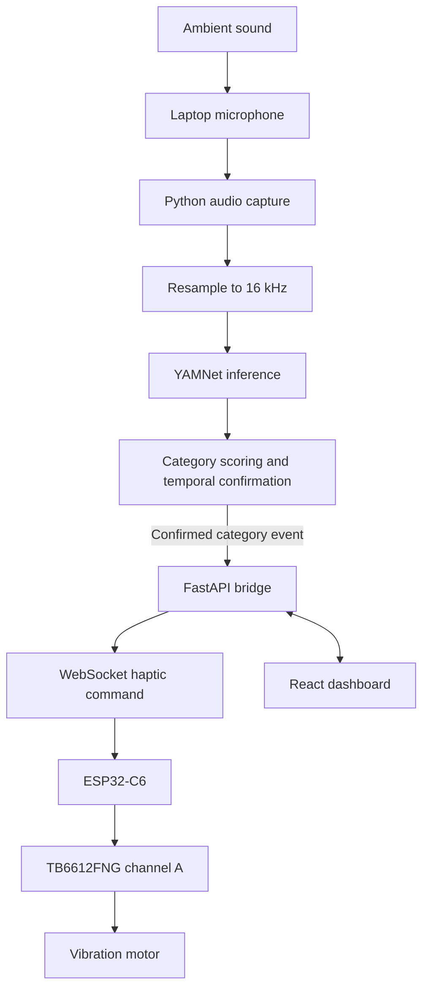

# Dhvani Mitra

<p align="center">
  <strong>An assistive sound-awareness system with customizable haptic alerts.</strong>
</p>

<p align="center">
  
  
  
  
  
  
</p>

Dhvani Mitra is an assistive-technology prototype that recognizes selected environmental sounds and communicates alerts through a wearable vibration motor. A local audio-classification process identifies configured sound categories; a FastAPI service routes events and haptic commands; an ESP32-C6 drives the motor through a TB6612FNG motor driver; and a React dashboard provides monitoring, history, device status, and vibration-pattern customization.

The project was developed as a hackathon prototype and received **3rd Prize**. This repository is intended to help students, engineers, researchers, and contributors understand and reproduce the implementation.

> **Scope and safety:** Dhvani Mitra is an experimental prototype, not a certified assistive device or emergency-warning system. It must not be used as the sole means of detecting hazards or protecting a person.

## At a glance

| Layer | Current implementation |
|---|---|
| Audio input | Microphone connected to the host laptop |
| Sound inference | Python + TensorFlow Hub YAMNet |
| Audio sample rate for inference | 16 kHz mono waveform |
| Sound categories | Alarm, vehicle horn, doorbell, knocking, siren |
| Application bridge | FastAPI REST API + WebSockets |
| User interface | React + Vite |
| Wearable controller | ESP32-C6 |
| Motor driver | TB6612FNG, channel A |
| Haptic output | One vibration motor in the documented active wristband build |
| Configuration | JSON pattern storage in the backend; browser-local UI preferences |
| Network | Local Wi-Fi network; laptop and ESP32-C6 must be reachable on the same LAN |

**Important architecture note:** The active end-to-end detector currently runs on the laptop. The ESP32-C6 wristband receives haptic commands; it does not run YAMNet or perform the active sound classification. A separate ESP32-C6 diagnostic firmware project tests an INMP441 I2S microphone and motor output on the bench. That diagnostic project is not the active end-to-end detection path.

## How it works



The detector sends category events and scores to the backend. It does **not** send the raw microphone waveform to FastAPI. See [Architecture](docs/ARCHITECTURE.md) for component responsibilities and message flow.

## Supported sound categories

| Category ID | User-facing label | Example AudioSet labels mapped by the detector |
|---|---|---|
| `ALARM` | Alarm | Alarm clock, smoke detector, fire alarm, car alarm, buzzer |
| `VEHICLE_HORN` | Vehicle horn | Vehicle horn, air horn, train horn |
| `DOORBELL` | Doorbell | Doorbell |
| `KNOCKING` | Knocking | Knock |
| `SIREN` | Siren | Siren, civil defense siren, police/ambulance/fire-engine siren |

The detector uses YAMNet's AudioSet class scores to form project-level categories. A displayed score is an aggregated model score; it is **not a calibrated probability** that an alert is correct. See [Detection pipeline](docs/ARCHITECTURE.md#sound-detection-pipeline).

## Repository layout

```text
.
├── backend/
│   ├── app/
│   │   ├── main.py              # FastAPI routes, WebSocket bridge and event routing
│   │   ├── schemas.py           # Pydantic message and validation models
│   │   └── storage.py           # Pattern and detection-history persistence
│   ├── data/                    # Runtime JSON data (created by the backend)
│   └── requirements.txt
├── detector/
│   ├── live_detector.py         # Laptop microphone capture and YAMNet inference
│   ├── run_laptop_mic.ps1       # Windows launcher
│   ├── README.md
│   └── requirements.txt
├── firmware/
│   ├── wristband/               # Active ESP32-C6 Wi-Fi/WebSocket haptic firmware
│   └── hardware_diagnostic/     # Separate INMP441/motor bench diagnostic
├── web/
│   ├── src/                     # React dashboard
│   └── package.json
├── docs/                        # Engineering documentation
└── README.md
```

## Quick start

The complete, reproducible setup is documented in [Development setup](docs/DEVELOPMENT.md). The short version is:

1. Install Python, Node.js, and ESP-IDF 6.1.
2. Install backend and detector dependencies in separate Python virtual environments.
3. Start the FastAPI backend on port `8000`.
4. Start the React/Vite dashboard.
5. Build, flash, and provision the ESP32-C6 wristband firmware.
6. Start the laptop microphone detector.
7. Confirm the detector and wristband are connected before running an end-to-end sound test.

The current supported launcher and commands are Windows PowerShell-oriented. Other operating systems may be usable with equivalent Python, Node.js, and ESP-IDF commands, but are not yet documented as verified platforms.

## Documentation

| Document | What it covers |
|---|---|
| [System architecture](docs/ARCHITECTURE.md) | Components, data flow, detector logic, event lifecycle |
| [Hardware guide](docs/HARDWARE.md) | Active wristband wiring, diagnostic microphone wiring, safety notes |
| [Communication protocol](docs/PROTOCOL.md) | REST endpoints, WebSocket routes, event and haptic payloads |
| [Development setup](docs/DEVELOPMENT.md) | Dependencies, setup, startup order, environment variables |
| [Testing and validation](docs/TESTING.md) | Reproduction checklist, test matrix, metrics to report |
| [Security and privacy](docs/SECURITY.md) | Audio handling, network exposure, credentials, limitations |
| [Contributing](CONTRIBUTING.md) | How to propose changes and document test evidence |

## Dashboard capabilities

The React dashboard currently provides:

- Live system and connection status for the detector and wristband.
- Current sound event and recent detection history.
- Per-category haptic pattern customization.
- Pattern preview and a physical wristband test command.
- Device connection information and configuration synchronization.
- JSON export and clearing of detection history.
- Browser-local custom sound profiles for storing and playing recordings.

**Custom sound profile limitation:** Adding a recording in the dashboard creates a browser-local profile only. It does not train YAMNet, add a new detector category, or make that sound automatically detectable.

## Current limitations

The following are intentional scope boundaries of the repository as currently implemented:

- Sound classification runs on the laptop, not on the ESP32-C6.
- The active wristband firmware controls one motor through TB6612FNG channel A.
- The INMP441 I2S code is a separate hardware diagnostic, not part of active inference.
- The dashboard does not receive battery telemetry from the wristband.
- Detection scores have not been documented as calibrated probabilities.
- No benchmark dataset or validated precision/recall/latency results are included yet.
- The backend and device WebSocket protocol are intended for a trusted local network; production authentication and transport encryption are not implemented.

See [Testing and validation](docs/TESTING.md) and [Security and privacy](docs/SECURITY.md) before extending or deploying the prototype.

## Recognition

Dhvani Mitra received **3rd Prize** at a hackathon. Add the official event name, organizer, date, team details, and a link to the certificate or event announcement here when those details are ready.

## Contributing

Contributions are welcome. Please read [CONTRIBUTING.md](CONTRIBUTING.md) before opening an issue or pull request. For changes to detection logic, include reproducible audio conditions and measured results; for hardware changes, include the board revision, wiring, power arrangement, and test procedure.

## Acknowledgements

This project was developed by a two-member team. Add contributor names, roles, mentor acknowledgements, and event-organizer acknowledgements here with the contributors' agreement.

## License

No license is declared by this documentation pack. Before accepting external contributions or encouraging reuse, the repository owner should choose and add an explicit open-source license. Until then, do not assume that public visibility grants permission to reuse the source.
