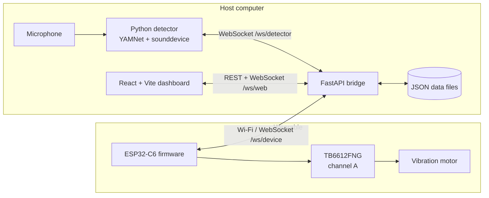
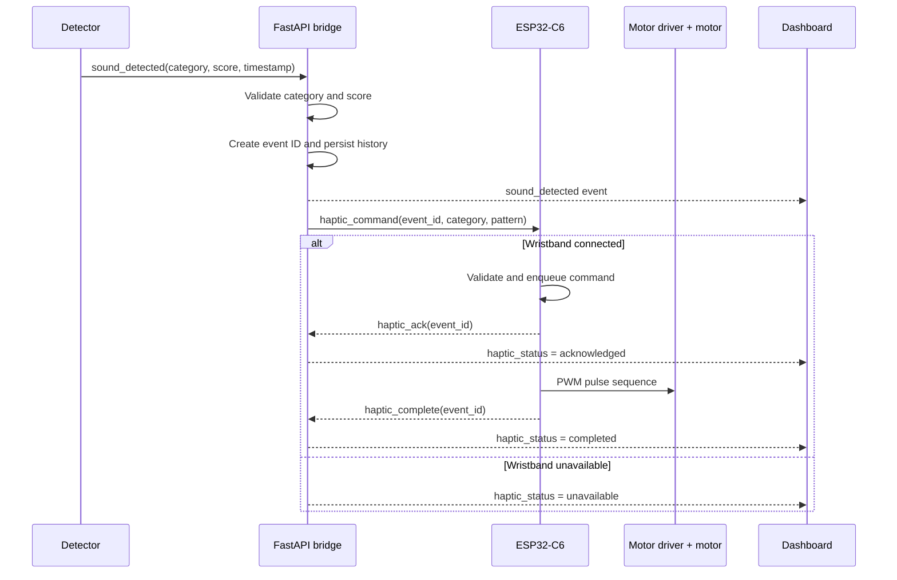

# System architecture

## 1. System context

Dhvani Mitra is a distributed prototype composed of four independently running software processes:

1. **Detector** — captures audio from a host-computer microphone and runs YAMNet inference.
2. **Backend bridge** — validates category events, stores history and haptic patterns, and routes commands.
3. **Wristband firmware** — connects to Wi-Fi and the backend, validates haptic commands, and drives a vibration motor.
4. **Web dashboard** — presents live status, event history, device status, and pattern controls.

The processes communicate over local TCP/IP. The detector and browser connect to separate backend WebSocket endpoints; the ESP32-C6 connects as a WebSocket device client.

## 2. Component diagram

## 3. Responsibility boundaries

| Component | Owns | Does not own |
|---|---|---|
| `detector/live_detector.py` | Audio capture, sample-rate conversion, YAMNet inference, category aggregation, temporal confirmation, cooldown | Motor timing, persistent history, dashboard rendering |
| `backend/app/main.py` | REST APIs, WebSocket sessions, schema validation, event IDs, routing and delivery-state broadcasts | Audio inference or direct GPIO control |
| `backend/app/schemas.py` | Allowed category IDs and payload validation | Model confidence calibration |
| `backend/app/storage.py` | Default patterns, JSON persistence, bounded history loading/saving | Database transactions or multi-user storage |
| `firmware/wristband/main/app_main.c` | Wi-Fi provisioning, WebSocket client, command validation, haptic queue, PWM and motor safety-off | Microphone capture or sound classification |
| `web/src/App.jsx` | UI state, live dashboard, pattern editing, browser-local profiles and history export | Training or changing the YAMNet model |

## 4. Sound detection pipeline

The active detector implementation is in `detector/live_detector.py`.

### 4.1 Capture and preprocessing

- The detector selects the Windows default input device unless `DHVANI_MIC_DEVICE` is configured.
- It captures mono floating-point audio in two-second windows.
- The input device's default sample rate is used for capture.
- Audio is resampled to the YAMNet-required 16 kHz sample rate when needed.
- A root-mean-square (RMS) level check skips inference when the window is below `MIN_AUDIO_LEVEL` (`0.003` in the current source).

### 4.2 Model inference and category aggregation

YAMNet produces frame-level class scores. The detector maps selected AudioSet labels into five project categories. For each category, it takes the maximum mapped class score per frame and aggregates the strongest 40% of frame values using `top_frame_average()`.

The source currently defines these category thresholds:

| Category | Threshold |
|---|---:|
| `ALARM` | 0.20 |
| `VEHICLE HORN` | 0.20 |
| `DOORBELL` | 0.15 |
| `KNOCKING` | 0.15 |
| `SIREN` | 0.20 |

These are implementation parameters, not validated universal thresholds. They should be tuned using a documented evaluation dataset and environment-specific testing.

### 4.3 Temporal confirmation and category competition

- The detector retains up to three Boolean detection decisions per category.
- A category becomes a candidate when at least two of the last three windows exceed its threshold.
- If both `ALARM` and `SIREN` are candidates and their scores differ by less than `0.08`, the detector treats the classification as ambiguous and waits.
- Otherwise, the highest-scoring confirmed category is selected.
- A three-second cooldown is tracked per category.
- The detector sends a `sound_detected` event to the backend.

**Interpretation warning:** The event's `confidence` field contains the detector's aggregated category score. It is not a calibrated probability or a user-independent measure of certainty.

## 5. Event-to-haptic lifecycle

The backend initially records delivery as `pending`, then updates the event to `sent` or `unavailable` depending on whether the device WebSocket send succeeds. The firmware acknowledges after accepting the command into its queue, and reports completion after the pulse sequence has finished.

These states describe transport and execution progress; `sent` does not by itself prove that the motor physically vibrated.

## 6. Haptic execution

The wristband firmware:

- Accepts `haptic_command` and `haptic_test` messages.
- Validates intensity and pulse-array bounds.
- Places accepted work into a FreeRTOS queue.
- Uses LEDC PWM at 20 kHz with 10-bit resolution for motor intensity.
- Drives TB6612FNG channel A.
- Returns the driver to standby after each pattern.
- Reports `haptic_ack` after queue acceptance and `haptic_complete` after playback.

The firmware currently supports up to eight pulses per command. Each pulse has an `on_ms` and `off_ms` duration. See [Communication protocol](PROTOCOL.md).

## 7. Persistence model

The backend stores:

- Vibration patterns in `backend/data/patterns.json`.
- Detection history in `backend/data/history.json`, retaining at most 500 events.

The browser also stores UI pattern preferences and custom sound-profile recordings in `localStorage`. These browser-local profiles are not synchronized as model classes and are not automatically recognized by the detector.

The JSON storage implementation uses a process-local re-entrant lock and temporary-file replacement. It is suitable for a single-user prototype, not a substitute for a transactional multi-user database.

## 8. Diagnostic firmware boundary

`firmware/hardware_diagnostic/` is a separate ESP-IDF project. It reads an INMP441 I2S microphone and reports left/right peak and RMS values. It also contains a manually triggered motor diagnostic whose enable flag must be checked before use.

This project is useful for bench-level electrical verification. It does not run YAMNet, classify environmental sounds, or participate in the active laptop-to-wristband event path.

## 9. Design constraints and future engineering questions

The following are useful future work items, not claims about current capabilities:

- Should inference remain on a laptop, move to a companion phone, or use a suitable edge-compute platform?
- How should a labeled test corpus be collected while protecting bystanders' privacy?
- What evaluation protocol should determine category thresholds and cooldown behavior?
- Should device commands carry sequence numbers, expiry times, and duplicate-suppression keys?
- Should the backend use SQLite or another transactional store?
- What authentication and encrypted transport are required before use outside a trusted LAN?
- How should battery state, motor faults, and device health be measured and reported?
